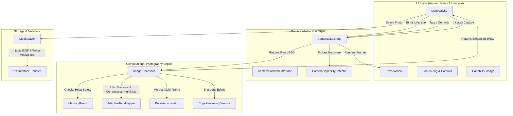
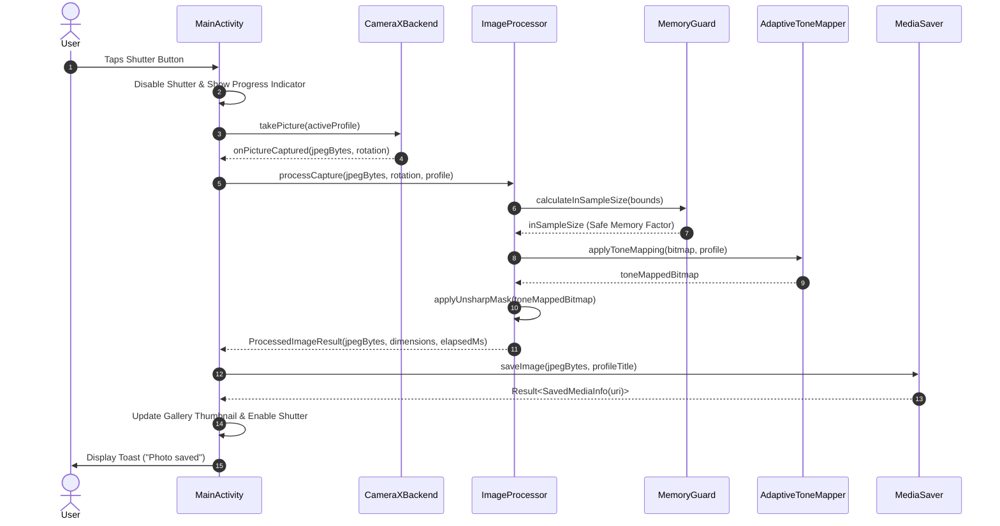

# System Architecture & Technical Design

## 1. Architectural Overview

**GCam Lite** is structured following modern Android Clean Architecture guidelines with reactive data flows, Kotlin Coroutines, and Android Jetpack components.

---

## 2. Module Breakdown

### 2.1 UI Layer (`com.gcam.compatible.camera.ui`)
- **`MainActivity`**: Manages activity lifecycle, UI animations, touch gestures (tap-to-focus and metering), runtime permissions, settings dialog, and gallery review thumbnail.
- Uses Android ViewBinding (`ActivityMainBinding`) for type-safe view lookups without overhead.

### 2.2 Camera Abstraction Layer (`com.gcam.compatible.camera.camera`)
- **`CameraBackend`**: Formal interface decoupling camera capture mechanics from the UI.
- **`CameraCapabilityDetector`**: Probes `CameraManager` for `INFO_SUPPORTED_HARDWARE_LEVEL`, `REQUEST_AVAILABLE_CAPABILITIES`, supported preview/capture resolutions, and flash availability. Categorizes devices into `LEGACY`, `LIMITED`, `FULL`, and `LEVEL_3`.
- **`CameraXBackend`**: Leverages CameraX (`camera-core`, `camera-camera2`, `camera-lifecycle`, `camera-view`), incorporating hundreds of vendor-specific quirk workarounds (Samsung, Xiaomi, Motorola, Transsion, MediaTek).

### 2.3 Computational Photography Engine (`com.gcam.compatible.camera.processing`)
- **`MemoryGuard`**: Evaluates JVM max heap, total heap, and free heap in real-time. Calculates safe `inSampleSize` downsampling and burst limits to protect low-RAM devices.
- **`BurstAccumulator`**: Executes weighted temporal pixel averaging across multi-frame bursts to reduce random photon shot noise and sensor read noise.
- **`AdaptiveToneMapper`**: Fast Look-Up Table (LUT) driven luminance remapping combining Reinhard-style soft highlight compression with gamma shadow lift.
- **`EdgePreservingDenoise`**: Spatial bilateral-like filter and unsharp mask filter to recover edge crispness after denoising.
- **`ImageProcessor`**: High-level coordinator executing stages concurrently on `Dispatchers.Default`.

### 2.4 Storage & Media Layer (`com.gcam.compatible.camera.storage`)
- **`MediaSaver`**: Handles modern Scoped Storage (`MediaStore.Images.Media.EXTERNAL_CONTENT_URI` with `IS_PENDING = 1`) on Android 10+ (API 29–34), and legacy direct DCIM file saving with `MediaScannerConnection` on Android 5.0–9.0 (API 21–28).

---

## 3. Capture & Processing Sequence

---

## 4. Lifecycle & Resource Guarantees

- **No Memory Leaks**: Camera use cases are bound to `LifecycleOwner`. Camera preview and image capture pipelines automatically halt on `onPause()` / `onStop()` and re-bind on `onResume()`.
- **Bitmap Recycling**: All intermediate Bitmaps generated during orientation correction, tone mapping, and sharpening are explicitly recycled via `.recycle()` to prevent memory accumulation in JVM heap.
- **Executor Teardown**: Dedicated camera executors are terminated on Activity destruction.
